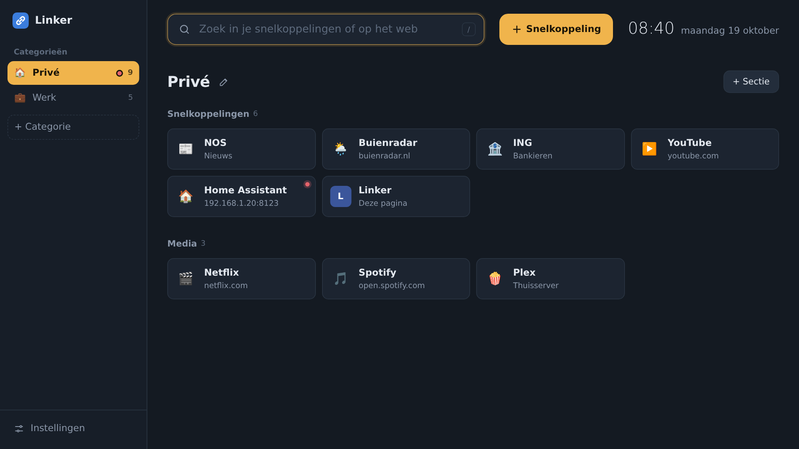
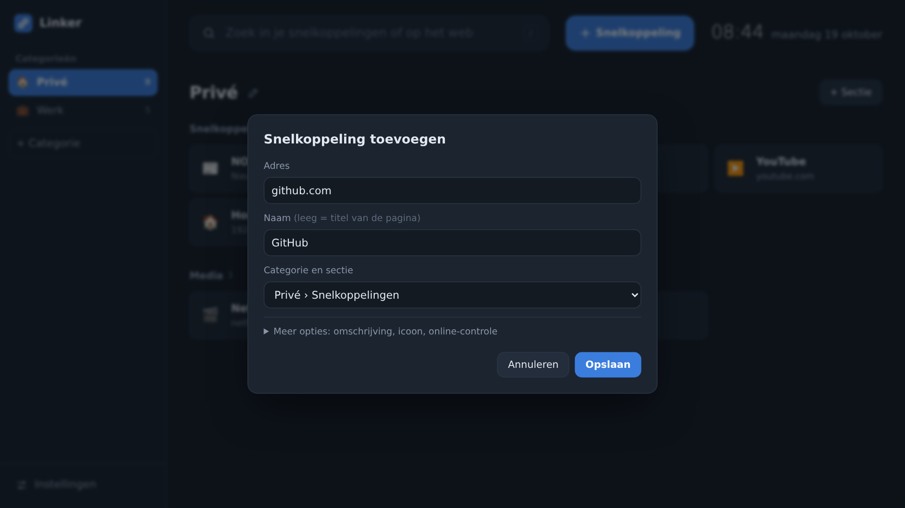
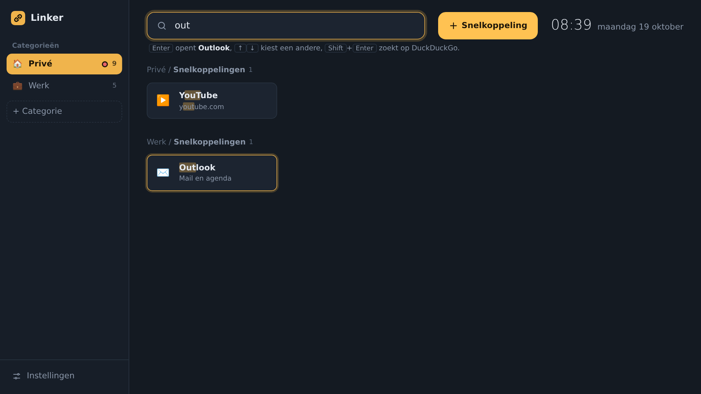

# Linker

Een lichte, zelf-gehoste verzamelplek voor je snelkoppelingen. Verdeel ze over **categorieën** in de zijbalk, zoals *Privé* en *Werk*, en binnen een categorie over secties. Toevoegen gaat snel: plak een adres, sleep een link uit een ander tabblad, of bewaar een website met één klik vanuit je bladwijzerbalk.

Alles draait in één container met SQLite. De pagina laadt geen scripts, fonts of trackers van buitenaf, dus hij werkt ook zonder internet. Alle instellingen doe je in de app zelf; in Portainer hoef je niets in te vullen.



## Functies

- **Categorieën → secties → snelkoppelingen.** Bij de eerste start staan *Privé* en *Werk* klaar. Wisselen met een klik of `Alt`+`1` tot `9`; Linker onthoudt waar je was.
- **Snel toevoegen**, op vier manieren:
  - de **+** naast een sectie: vul alleen het adres in, de naam wordt de titel van de pagina;
  - **plak** een adres met `Ctrl`+`V` ergens op de pagina;
  - **sleep** een link of het adres uit een ander tabblad op de pagina (of op een sectie);
  - de **bladwijzer-knop "+ Naar Linker"** (te vinden in *Instellingen*): sleep hem naar je bladwijzerbalk en bewaar elke website met één klik. Na het opslaan ga je terug naar de pagina.
- **Ordenen**: sleep snelkoppelingen, secties en categorieën om de volgorde te wijzigen. Laat een snelkoppeling of sectie op een categorie in de zijbalk vallen om hem te verplaatsen. Een sectie sorteer je met één klik van A tot Z.
- **Zoeken met het toetsenbord**: begin gewoon met typen of druk op `/` (of klik op *Zoeken* in de zijbalk). De zoekbalk verschijnt pas dan, en verdwijnt weer met `Esc`.
  - Doorzoekt alle categorieën tegelijk (naam, omschrijving en adres).
  - `Enter` opent de beste treffer, `↑` `↓` kiest een andere, `Esc` wist.
  - `Shift`+`Enter` zoekt op het web: DuckDuckGo, Google, Startpage, Bing, Brave, Kagi, Ecosia of een eigen zoekmachine.
- **Iconen** zonder gedoe: automatisch het icoon van de site (ook voor diensten in je thuisnetwerk), of een appnaam zoals `outlook` of `plex` uit [dashboard-icons](https://github.com/homarr-labs/dashboard-icons) / [selfh.st/icons](https://github.com/selfhst/icons), een eigen upload, een afbeeldingsadres of een emoji. Iconen worden in `/config` bewaard.
- **Online-controle** (optioneel per snelkoppeling): een groen of rood bolletje, ook op de categorie in de zijbalk. Zet je aan met het vinkje bij het toevoegen; standaard staat het uit.
- **Zijbalk op maat**: sleep de rechterrand om hem breder of smaller te maken; dubbelklik zet hem terug.
- **Uiterlijk**: optioneel iconen bij de categorieën; licht, donker, OLED of automatisch, een eigen accentkleur, normale of compacte kaarten, en een eigen achtergrondafbeelding.
- **Importeren** van de bladwijzers uit je browser (HTML-export uit Chrome, Firefox, Edge of Safari; elke map wordt een sectie), een ctrlTAB-back-up of een Linkwarden-export.
- **Back-up** downloaden en terugzetten als JSON.
- **Bewerken beveiligen** met een optioneel wachtwoord. Openen en zoeken blijft voor iedereen mogelijk; alleen wijzigen vraagt om het wachtwoord.
- **Installeerbaar als app** (PWA) op telefoon en desktop.





## Installeren in Portainer

### Optie A: Web editor met kant-en-klare image (aanbevolen)

GitHub Actions bouwt bij elke push naar `main` een image: `ghcr.io/richrdj/linker:latest` (amd64 + arm64).

1. Portainer → **Stacks** → **Add stack** → **Web editor**
2. Plak de inhoud van [`portainer-stack.yml`](portainer-stack.yml).
3. **Deploy the stack** → open `http://<server>:5656`

> Is de repository privé? Maak dan het package op GitHub openbaar (Packages → linker → Package settings → Change visibility), of voeg `ghcr.io` toe als registry in Portainer met een GitHub-token met de scope `read:packages`.

### Optie B: Rechtstreeks vanuit Git (Portainer bouwt zelf)

1. Portainer → **Stacks** → **Add stack** → **Repository**
2. Repository URL: `https://github.com/RichrdJ/linker`, Compose path: `docker-compose.yml`
3. Bij een privé-repo: zet *Authentication* aan en gebruik een GitHub-token.
4. Deploy. Met *GitOps updates* haalt Portainer nieuwe versies automatisch op.

### Optie C: docker compose

```bash
git clone https://github.com/RichrdJ/linker.git && cd linker
docker compose up -d --build
```

### Als startpagina van je browser

Stel `http://<server>:5656` in als startpagina en als pagina voor nieuwe tabbladen (in Chrome en Firefox kan dat laatste met een extensie zoals *New Tab Redirect*). Wil je Linker buiten je thuisnetwerk gebruiken, zet er dan een reverse proxy met HTTPS voor, bijvoorbeeld Nginx Proxy Manager, Traefik of Caddy, en stel een wachtwoord in.

De database staat in het volume `linker-config` (`/config/linker.db`, met geüploade iconen en achtergrond in `/config/uploads`). Neem dat volume mee in je back-ups, of download af en toe een back-up via *Instellingen*.

## Omgevingsvariabelen

| Variabele | Standaard | Uitleg |
|---|---|---|
| `TZ` | – | Tijdzone |
| `PUID` / `PGID` | (root) | Gebruiker/groep die eigenaar wordt van `/config` |
| `PORT` | `5656` | Poort binnen de container |
| `LOG_LEVEL` | `INFO` | |

## Lokaal ontwikkelen

```bash
pip install -r requirements.txt
DATA_DIR=./config uvicorn app.main:app --reload --port 5656
```

Open daarna http://localhost:5656.

## Versies

Alle wijzigingen per versie staan in [CHANGELOG.md](CHANGELOG.md) en onder [Releases](https://github.com/RichrdJ/linker/releases). Het versienummer van je installatie staat onderaan *Instellingen*.

- `:latest` volgt `main`, `:0.3.1` is een vaste versie.
- Wil je zelf bepalen wanneer je updatet? Zet dan een vast versienummer in `portainer-stack.yml`, bijvoorbeeld `:0.3.1`.

**Nieuwe versie uitbrengen:** werk `CHANGELOG.md` en `app/VERSION` bij, commit, en push met een tag:

```bash
git tag -a v0.4.0 -m "v0.4.0" && git push && git push --tags
```

GitHub Actions bouwt dan de image `:0.4.0` en maakt de release aan met de tekst uit de changelog.
