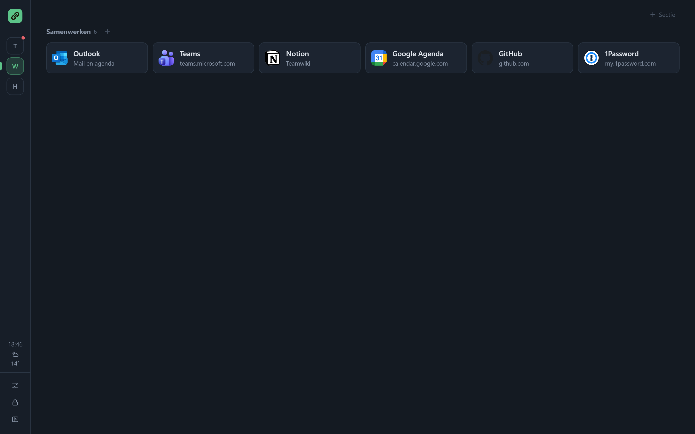
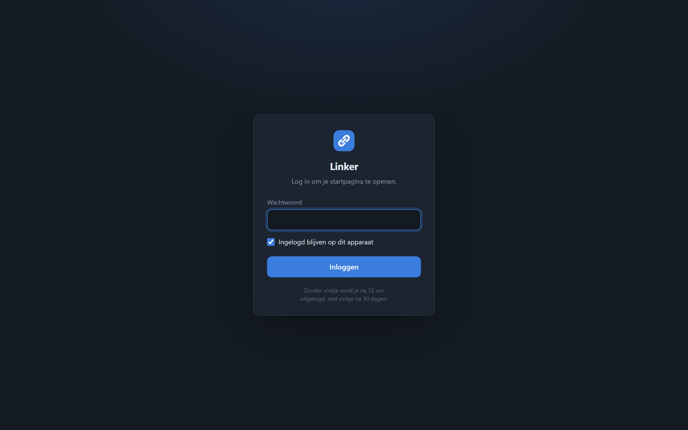

# Linker

Een lichte, zelf-gehoste verzamelplek voor je snelkoppelingen. Verdeel ze over **categorieën** in de zijbalk, zoals *Privé* en *Werk*, en binnen een categorie over secties. Toevoegen gaat snel: plak een adres, sleep een link uit een ander tabblad, of bewaar een website met één klik vanuit je bladwijzerbalk.

Alles draait in één container met SQLite. De pagina laadt geen scripts, fonts of trackers van buitenaf, dus hij werkt ook zonder internet. Alle instellingen doe je in de app zelf; in Portainer hoef je niets in te vullen.

<picture>
  <source media="(prefers-color-scheme: light)" srcset="docs/images/startpagina-light.png">
  
</picture>

## Functies

- **Categorieën → secties → snelkoppelingen.** Bij de eerste start staan *Privé* en *Werk* klaar. Wisselen met een klik of `Alt`+`1` tot `9`; Linker onthoudt waar je was.
- **Snel toevoegen**, op vier manieren:
  - de **+** naast een sectie: vul alleen het adres in, de naam wordt de titel van de pagina;
  - **plak** een adres met `Ctrl`+`V` ergens op de pagina;
  - **sleep** een link of het adres uit een ander tabblad op de pagina (of op een sectie);
  - de **bladwijzer-knop "+ Naar Linker"** (te vinden in *Instellingen*): sleep hem naar je bladwijzerbalk en bewaar elke website met één klik. Na het opslaan ga je terug naar de pagina.
- **Ordenen**: sleep snelkoppelingen, secties en categorieën om de volgorde te wijzigen. Laat een snelkoppeling of sectie op een categorie in de zijbalk vallen om hem te verplaatsen. Een sectie sorteer je met één klik van A tot Z of op meest bezocht, of je laat Linker de meest bezochte snelkoppelingen vanzelf bovenaan zetten.
- **Zoeken met het toetsenbord**: begin gewoon met typen of druk op `/` (op je telefoon: het vergrootglas). De zoekbalk verschijnt pas dan, en verdwijnt weer met `Esc`.
  - Doorzoekt alle categorieën tegelijk (naam, omschrijving en adres).
  - `Enter` opent de beste treffer, `↑` `↓` kiest een andere, `Esc` wist.
  - `Shift`+`Enter` zoekt op het web: DuckDuckGo, Google, Startpage, Bing, Brave, Kagi, Ecosia of een eigen zoekmachine.
- **Iconen** zonder gedoe: automatisch het icoon van de site (ook voor diensten in je thuisnetwerk), of een appnaam zoals `outlook` of `plex` uit [dashboard-icons](https://github.com/homarr-labs/dashboard-icons) / [selfh.st/icons](https://github.com/selfhst/icons), een eigen upload, een afbeeldingsadres of een emoji. Iconen worden in `/config` bewaard.
- **Online-controle** (optioneel per snelkoppeling): een groen of rood bolletje, ook op de categorie in de zijbalk. Zet je aan met het vinkje bij het toevoegen; standaard staat het uit.
- **Zijbalk op maat**: sleep de rechterrand om hem breder of smaller te maken (dubbelklik zet hem terug), of klap hem in tot een smalle strook. Onderin staan rustig de klok, de datum en het weer.
- **Uiterlijk**: optioneel iconen bij de categorieën; licht, donker, OLED of automatisch, een eigen accentkleur, normale of compacte kaarten, en een eigen achtergrondafbeelding.
- **Importeren** van de bladwijzers uit je browser (HTML-export uit Chrome, Firefox, Edge of Safari; elke map wordt een sectie), een ctrlTAB-back-up of een Linkwarden-export.
- **Back-up** downloaden en terugzetten als JSON.
- **Beveiligen** met een wachtwoord: alleen bewerken afschermen, of met **Inloggen verplicht** de hele startpagina achter een loginpagina zetten, zodat je Linker veilig via internet kunt gebruiken.
- **Eigen kleur per categorie**: bijvoorbeeld Thuis blauw en Werk groen. Het logo en het icoon in je tabblad kleuren mee.
- **Weer** klein onder de klok, via [Open-Meteo](https://open-meteo.com) (gratis, geen account). Alleen de server haalt het op; je plaats staat alleen in je eigen database.
- **Installeerbaar als app** (PWA) op telefoon en desktop.

### Zo ziet het eruit

| | |
|---|---|
|  |  |
| **Zoeken**: begin te typen, `Enter` opent de beste treffer. | **Toevoegen**: plak een adres, de naam en het icoon komen vanzelf. |
|  |  |
| **Ingeklapt en in kleur**: Werk in het groen, de zijbalk als smalle strook. | **Inloggen**: veilig via internet, met bescherming tegen raden. |

<sub>Screenshots met verzonnen voorbeeldgegevens. Iconen uit [dashboard-icons](https://github.com/homarr-labs/dashboard-icons).</sub>

## Installeren in Portainer

### Optie A: Web editor met kant-en-klare image (aanbevolen)

GitHub Actions bouwt bij elke push naar `main` een image: `ghcr.io/richrdj/linker:latest` (amd64 + arm64).

1. Portainer → **Stacks** → **Add stack** → **Web editor**
2. Plak de inhoud van [`portainer-stack.yml`](portainer-stack.yml).
3. **Deploy the stack** → open `http://<server>:5656`

> Is de repository privé? Maak dan het package op GitHub openbaar (Packages → linker → Package settings → Change visibility), of voeg `ghcr.io` toe als registry in Portainer met een GitHub-token met de scope `read:packages`.

### Optie B: Rechtstreeks vanuit Git (Portainer bouwt zelf)

1. Portainer → **Stacks** → **Add stack** → **Repository**
2. Repository URL: `https://github.com/RichrdJ/linker`, Compose path: `docker-compose.yml`
3. Bij een privé-repo: zet *Authentication* aan en gebruik een GitHub-token.
4. Deploy. Met *GitOps updates* haalt Portainer nieuwe versies automatisch op.

### Optie C: docker compose

```bash
git clone https://github.com/RichrdJ/linker.git && cd linker
docker compose up -d --build
```

### Als startpagina van je browser

Stel `http://<server>:5656` in als startpagina en als pagina voor nieuwe tabbladen (in Chrome en Firefox kan dat laatste met een extensie zoals *New Tab Redirect*).

### Via internet bereikbaar maken

1. Zet er een reverse proxy met HTTPS voor, bijvoorbeeld Nginx Proxy Manager, Traefik of Caddy. Stel Linker nooit zonder HTTPS open.
2. Open *Instellingen → Wachtwoord en inloggen*, kies een sterk wachtwoord (minstens 8 tekens, liefst een zin of een wachtwoord uit je wachtwoordmanager) en zet **Inloggen verplicht voor de hele startpagina** aan.
3. Zet poort `5656` niet open in je router: alleen de reverse proxy hoeft Linker te bereiken.

Wat Linker dan zelf doet:

- Zonder login is alleen de loginpagina te zien. Alle snelkoppelingen, iconen, je achtergrond en de API vragen om een login.
- Na 5 foute pogingen vanaf hetzelfde adres volgt een blokkade van 15 minuten. Bij meer dan 30 foute pogingen in 15 minuten worden alle logins tijdelijk geweigerd, ook als een aanvaller zijn adres vervalst.
- Het sessiecookie is `HttpOnly` en `SameSite=Lax`, en krijgt `Secure` zodra de pagina via HTTPS binnenkomt (ook achter je proxy). Je blijft 30 dagen ingelogd, of 12 uur als je *Ingelogd blijven* uitvinkt.
- Een nieuw wachtwoord logt alle andere apparaten uit. Met *Uitloggen* in de zijbalk log je het huidige apparaat uit.
- De pagina mag niet in een frame van een andere site worden geladen.

**Wachtwoord vergeten?** Start de container eenmalig met de omgevingsvariabele `RESET_PASSWORD=1`. Dan staan het wachtwoord en het verplicht inloggen uit. Haal de variabele daarna weer weg en stel een nieuw wachtwoord in.

De database staat in het volume `linker-config` (`/config/linker.db`, met geüploade iconen en achtergrond in `/config/uploads`). Neem dat volume mee in je back-ups, of download af en toe een back-up via *Instellingen*.

## Omgevingsvariabelen

| Variabele | Standaard | Uitleg |
|---|---|---|
| `TZ` | – | Tijdzone |
| `PUID` / `PGID` | (root) | Gebruiker/groep die eigenaar wordt van `/config` |
| `PORT` | `5656` | Poort binnen de container |
| `LOG_LEVEL` | `INFO` | |
| `RESET_PASSWORD` | – | `1` = wachtwoord en verplicht inloggen uitzetten bij het starten (wachtwoord vergeten) |

## Lokaal ontwikkelen

```bash
pip install -r requirements.txt
DATA_DIR=./config uvicorn app.main:app --reload --port 5656
```

Open daarna http://localhost:5656.

## Versies

Alle wijzigingen per versie staan in [CHANGELOG.md](CHANGELOG.md) en onder [Releases](https://github.com/RichrdJ/linker/releases). Het versienummer van je installatie staat onderaan *Instellingen*.

- `:latest` volgt `main`, `:0.3.1` is een vaste versie.
- Wil je zelf bepalen wanneer je updatet? Zet dan een vast versienummer in `portainer-stack.yml`, bijvoorbeeld `:0.3.1`.

**Nieuwe versie uitbrengen:** werk `CHANGELOG.md` en `app/VERSION` bij, commit, en push met een tag:

```bash
git tag -a v0.4.0 -m "v0.4.0" && git push && git push --tags
```

GitHub Actions bouwt dan de image `:0.4.0` en maakt de release aan met de tekst uit de changelog.
